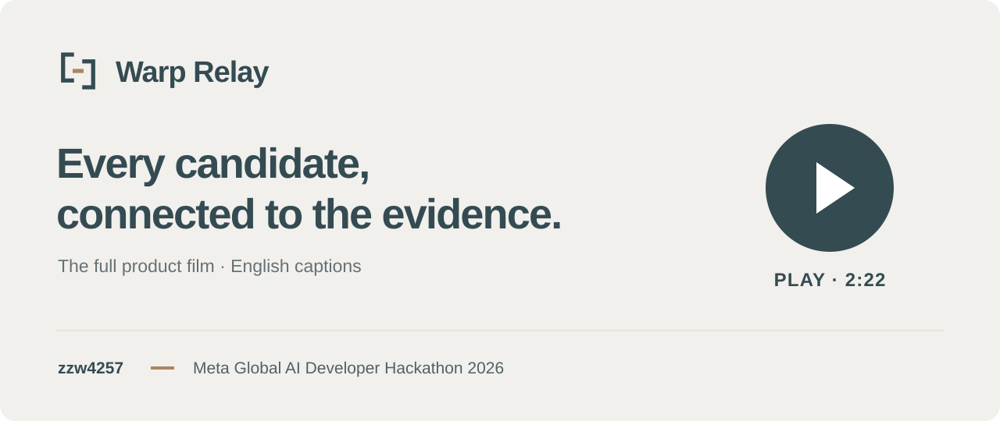
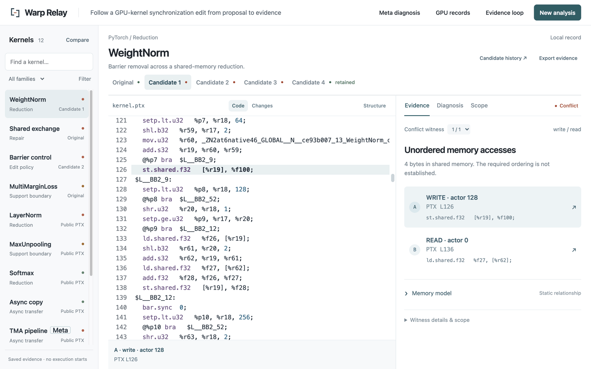
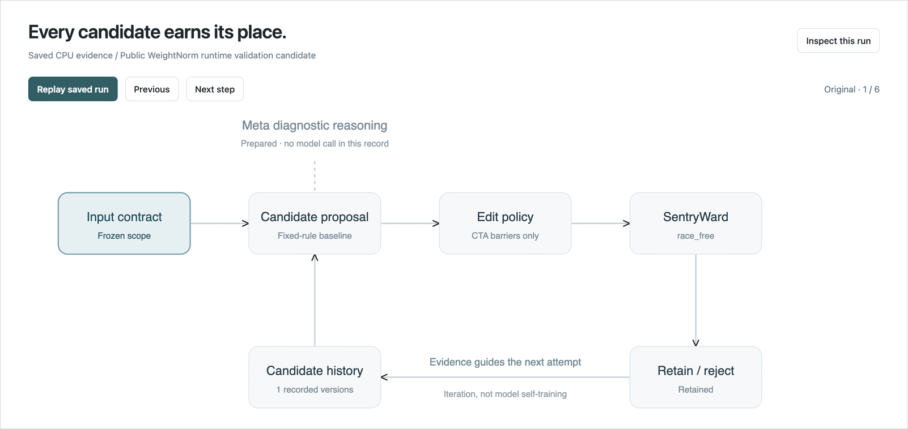
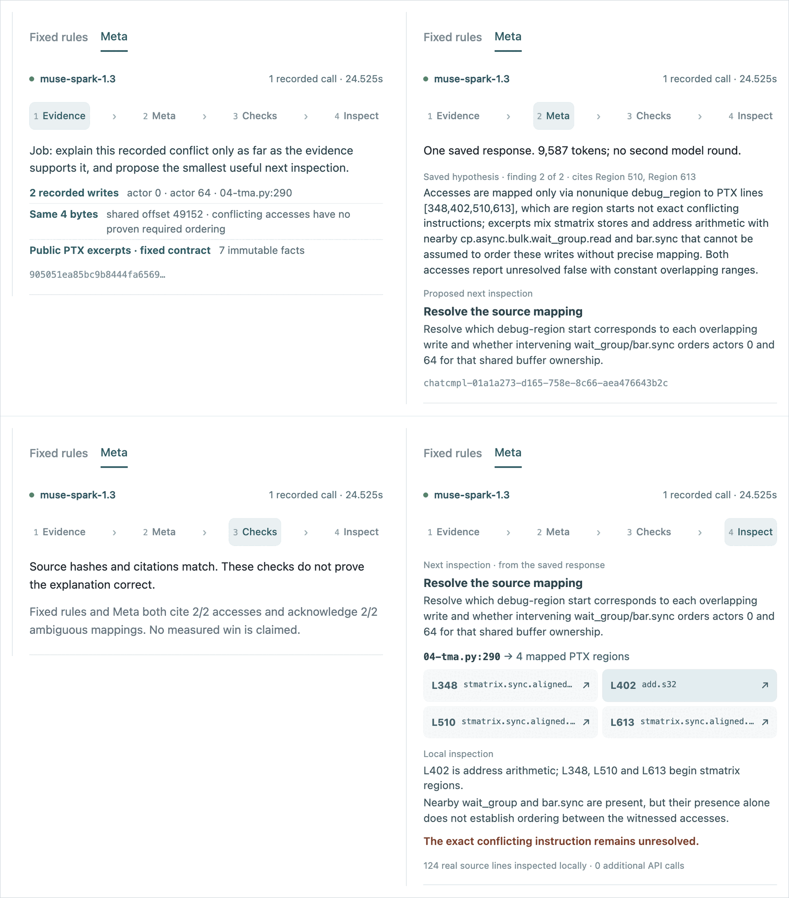
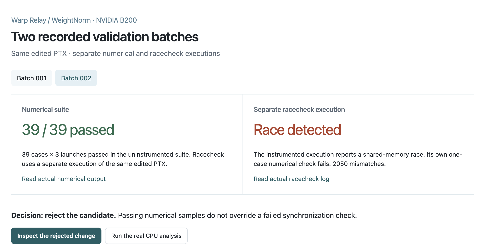

<a id="top"></a>

<p align="center">
  <picture>
    <source media="(prefers-color-scheme: dark)" srcset="docs/assets/readme/warp-relay-mark-dark.svg">
    
  </picture>
</p>

<h1 align="center">Warp Relay</h1>

<p align="center">
  <strong>Every candidate, connected to the evidence.</strong>
  <br>
  A local workbench that follows a GPU-kernel synchronization edit from proposal to evidence.
</p>

<p align="center">
  <b>12 curated cases</b> · <b>4 local CPU archives</b> · <b>2 recorded B200 trials</b> · <b>1 recorded Meta diagnosis</b> · <b>runs offline</b>
</p>

<p align="center">
  <a href="LICENSE"></a>
  <a href="pyproject.toml"></a>
  <a href="#get-started-in-60-seconds"></a>
  <a href="docs/provenance.md"></a>
</p>

<p align="center">
  <a href="https://youtu.be/Dbbt4qoKmiI">Watch the 2:22 demo</a> —
  <a href="#get-started-in-60-seconds">Quickstart</a> —
  <a href="#how-it-works-in-30-seconds">How it works</a> —
  <a href="#metas-role">Meta’s role</a> —
  <a href="#what-the-evidence-supports">Evidence</a> —
  <a href="docs/README.md">Docs</a> —
  <a href="CONTRIBUTING.md">Contributing</a> —
  <a href="CHANGELOG.md">Changelog</a>
</p>

<p align="center">
  <a href="https://youtu.be/Dbbt4qoKmiI" title="Play the Warp Relay film on YouTube">
    
  </a>
  <br>
  <a href="https://youtu.be/Dbbt4qoKmiI"><strong>▶ Watch the full film</strong></a> · 2:22 · English captions
</p>

> [!NOTE]
> Built by [zzw4257](https://github.com/zzw4257) for the
> [Meta Global AI Developer Hackathon 2026](https://dev.meta.ai/events/global-hackathon),
> **Indie Developer Track · Push the Frontier**. This repository is currently
> private for review; the [demo film](https://youtu.be/Dbbt4qoKmiI) is available by link.
> Competition submission is pending. Warp Relay is an independent project.
> [Release scope](docs/release-scope.md) · [Delivery status](docs/hackathon/delivery-status-round53.md).

## Why Warp Relay

A kernel edit can produce the right sampled answers and still contain a race.
In recorded B200 batch 002, the barrier-deletion candidate passed the
**39-case numerical suite**. A **separate racecheck execution of the same
edited PTX** detected a shared-memory race; its own one-case numerical check
failed. The processes differ in coverage and instrumentation.
[Inspect the commands and raw results](docs/gpu-claim-audit.md).
The useful question isn't "did the output look right?" but "which accesses lost
their ordering, and can I see the proof?"

Warp Relay keeps the kernel, its frozen input contract, each candidate edit and
the evidence for every decision in one place. Retained, rejected and inconclusive
results stay distinct. In the bundled demo, every value on screen is read from a
saved record; a new CPU analysis writes its own record as it runs.

## What it does

<p align="center">
  
  <br>
  <sub>Real screen, served from this tree with no GPU or model key. WeightNorm Candidate 1 deletes one barrier; the verifier links an unordered write (PTX L126) to a read (L136), so the candidate is rejected. <b>Meta diagnosis</b> in the header opens the recorded model response.</sub>
</p>

- **Case library.** Twelve cases from PyTorch, Triton Gluon, TileLang and TIRx
  kernels plus original microfixtures, each with its contract, versions and verifier record.
- **Linked evidence.** Select a reported access and jump to the PTX line. When a
  source line only maps to debug regions, the workbench says so instead of guessing.
- **Bounded CPU loop.** A fixed-rule provider inserts or removes standalone
  `bar.sync 0;` instructions; the pinned SentryWard verifier rechecks each candidate
  under the same contract. Jobs can be started, cancelled and retried.
- **Auditable Meta diagnosis.** One recorded `muse-spark-1.3` response, shown as
  **Evidence → Meta → Checks → Inspect** and audited offline against its inputs.
- **Separate GPU records.** Two saved B200 batches keep separate numerical tests, racecheck
  and timing apart. Opening the app never starts a GPU job.
- **Honest outcomes.** Unsupported inputs stop as `unsupported`; they never
  become passes.

## Get started in 60 seconds

Requires Python 3.10+ on macOS or Linux (Windows is not validated). No
`pip install`, GPU, model key, npm or network access is needed to browse the
bundled evidence.

```sh
python3 scripts/verify_public_snapshot.py
python3 -m warp_relay serve --port 8876 --state runs/my-workbench
```

The first command checks every file against `PUBLIC-MANIFEST.json` and loads
the recorded data. Its complete output:

```json
{
  "case_count": 12,
  "loadable_cpu_presets": 4,
  "recorded_gpu_trials": 2,
  "recorded_model": "muse-spark-1.3",
  "new_model_calls": 0,
  "new_gpu_runs": 0,
  "manifest_verified": true
}
```

With the server running on port 8876, each link opens one piece of evidence
directly:

| Open | What you'll see |
| --- | --- |
| [WeightNorm · Candidate 1](http://127.0.0.1:8876/#case/weightnorm/candidate-1/evidence) | The linked write (PTX L126) and read (L136) that reject this barrier deletion. **Changes** shows the removed barrier |
| [Meta · recorded input](http://127.0.0.1:8876/#case/tma/public-ptx/meta/evidence) | Step 1 of the recorded Meta diagnosis, also opened by **Meta diagnosis** in the header |
| [Meta · Inspect L402](http://127.0.0.1:8876/#case/tma/public-ptx/meta/inspect/L402) | Step 4: Python line 290's region at PTX L402 is address arithmetic |
| [B200 records](http://127.0.0.1:8876/#story) | Two validation batches: separate numerical and racecheck executions |

On another port, change `8876` in the link. The address bar keeps the case,
version, tab, Meta step and inspected Meta region, so a reload or a copied URL
returns there. Links only choose what to show; they never run or change anything.

Until you build the native verifier, the workbench reports *Verifier setup
required*. That is expected; every recorded view still works.

The [native-build validation](docs/native-validation.md) records a fresh Mac
build and passing results for all 73 distinct Python tests, including the
isolated loopback-permission retest. No new model or GPU call was needed.

<details>
<summary><b>Run a new CPU analysis (builds the pinned verifier)</b></summary>

<br>

Needs an existing C++20 compiler, CMake 3.27+, Ninja, OpenSSL, Boost headers,
Z3 and Git. `bootstrap.sh` fetches [SentryWard](https://github.com/gpu-verifier/sentryward)
at a pinned commit; it doesn't install system packages or reset an existing checkout.

```sh
sh scripts/bootstrap.sh
python3 -m warp_relay doctor
python3 -m warp_relay run examples/neighbor_exchange/task.json \
  --out runs/my-repair --iterations 3
```

Use a new output directory each time. You can also load a sample under
**New analysis** in the workbench. [Reproduction](docs/reproduction.md) covers
the public WeightNorm run, the expected `unsupported` exit and the offline Meta audit.

</details>

## How it works in 30 seconds

<p align="center">
  
  <br>
  <sub>The app's own Evidence loop view for the saved public WeightNorm run. Iteration is driven by verifier evidence, not model self-training.</sub>
</p>

Each run freezes the input contract and verifies the original kernel. Fixed rules
then propose one barrier edit at a time, an admission check rejects anything but
barrier changes, and SentryWard rechecks every candidate under the same contract.
The last accepted version is retained; every rejected candidate stays on disk
with its evidence. Modules, data flow and guarantees: [Architecture](docs/architecture.md).

## Meta’s role

We sent **one** request to Meta's `muse-spark-1.3` with an immutable verifier
packet for the TMA pipeline case. The saved response explains the conflict as far
as the evidence supports it and proposes the next inspection. The workbench
replays that record; it does not call the model.

In the workbench (**Meta diagnosis** in the header, or `#case/tma/public-ptx/meta/evidence`)
the record unfolds in four steps:

1. **Evidence.** The packet sent to the model: two recorded 4-byte writes (actors 0 and 64)
   overlap at shared offset 49152 with no proven ordering, plus public PTX excerpts
   and the fixed contract.
2. **Meta.** The saved response: one call, 9,587 tokens, a hypothesis that cites
   its evidence, and a proposed next inspection ("resolve the source mapping").
3. **Checks.** Local validation: source hashes and citations match. These checks
   don't prove the explanation correct.
4. **Inspect.** The proposed inspection, carried out locally: Python line 290 maps to
   four PTX regions. L402 is address arithmetic; L348, L510 and L613 begin `stmatrix`
   stores. The exact conflicting instruction pair **remains unresolved**.

<p align="center">
  
  <br>
  <sub>Step 4 as rendered in the workbench (unretouched crop). Each region opens the real PTX line.</sub>
</p>

<details>
<summary><b>All four steps as rendered</b></summary>

<br>

<a href="docs/assets/readme/meta-diagnosis-stages.png"></a>
<br>
<sub>Unretouched crops of the evidence panel at each step. Open the image for full resolution.</sub>

</details>

| Recorded fact | Value |
| --- | --- |
| Model, calls | `muse-spark-1.3`, 1 request, 0 retries, no second round |
| Latency, usage | 24.525 s, 6,278 input + 3,309 output tokens |
| What it contributed | A diagnosis hypothesis plus a proposed next inspection, tied to cited evidence |
| What local checks confirmed | Source hashes, request hash and typed citations; Python line 290 maps to PTX regions 348, 402, 510 and 613; L402 is address arithmetic |
| What it does **not** show | A model-driven repair, or any advantage over the fixed-rule baseline: both cite 2/2 accesses and 2/2 mapping limits |

Audit it yourself, with no API call:

```sh
python3 scripts/audit_meta_review.py evidence/round23-meta/first-response \
  --out runs/meta-audit --no-install
```

Full record: [First Meta response](docs/first-meta-response.md) ·
[Investigation design](docs/evidence-investigation.md).

## What the evidence supports

| Workflow | Demonstrated result | Scope |
| --- | --- | --- |
| Public WeightNorm, CPU | Three barrier deletions rejected; a fourth retained | Fixed launch, synchronization only; the barrier it removes sits on a path this launch never executes |
| Shared-exchange microfixture | Inserted barrier retained after verification | Small, hand-authored, not a production benchmark |
| Recorded B200 negative control | Numerical suites: 35/39 in batch 001, 39/39 in batch 002; separate racecheck executions both report a race | Same edited PTX; distinct executions and coverage; instrumented numerical checks fail |
| Recorded Meta TMA diagnosis | Hypothesis → four real PTX regions inspected locally | One model call; exact conflicting instructions unresolved |
| Eight imported upstream cases | Saved public SentryWard results with source and scope | Displayed from records, not re-executed here |

<p align="center">
  
  <br>
  <sub>B200 batch 002 groups two separate executions of the same edited PTX: the numerical suite passes, while racecheck reports a race. The candidate remains rejected.</sub>
</p>

**What we don't claim:** a GPU speedup, a held-out model advantage, general
numerical equivalence, or model self-training. Synchronization acceptance is not
whole-program correctness. Where provenance is incomplete (the Online softmax and
RMSNorm generators), [the provenance table](docs/provenance.md) says so.

## Who it's for

**Use it** to inspect barrier edits on small, fixed-launch PTX kernels; to show a
reviewer *why* a candidate was kept or rejected; or to study how a model diagnosis
can be checked against verifier evidence.

**Skip it** if you need a general kernel optimizer, CUDA-source rewriting,
performance tuning, or a hosted multi-user service. The server binds to loopback
only and has no authentication.

## Repository map

<details>
<summary><b>Where things live</b></summary>

<br>

| Path | Contents |
| --- | --- |
| `warp_relay/` | Runner, admission policy, providers, diagnosis/audit, workbench server, bundled case records and compiled UI (`web/`) |
| `ui/` | Workbench source (vanilla JavaScript, Pierre Diffs, [Three.js](https://threejs.org)); `package-lock.json` pins the build |
| `examples/` | Input contracts: shared-exchange microfixture, public WeightNorm, unsupported MultiMarginLoss |
| `evidence/` | Saved CPU archives, two B200 trials and the recorded Meta request/response/audit |
| `gpu/` | Reviewed WeightNorm reference and validation harness (needs a separately authorized SM100 allocation) |
| `scripts/` | Bootstrap, snapshot verification, Meta audit, release checks |
| `tests/` | Python regression tests; UI tests live in `ui/src/*.test.mjs` |
| `docs/` | Guides, provenance and release records ([index](docs/README.md)) |

</details>

## Documentation

| Start here | Go deeper | Project records |
| --- | --- | --- |
| [Reproduction & tests](docs/reproduction.md) | [Architecture](docs/architecture.md) | [Changelog](CHANGELOG.md) |
| [Workbench guide](docs/README.md#use-the-workbench) | [Input contract](docs/input-contract.md) | [Release scope & licenses](docs/release-scope.md) |
| [First Meta response](docs/first-meta-response.md) | [GPU validation method](docs/gpu-validation.md) | [Case provenance](docs/provenance.md) |
| [Supported public case](docs/supported-public-case.md) | [Evidence investigation](docs/evidence-investigation.md) | [Hackathon records](docs/hackathon/) |

## Contributing

Issues and pull requests are welcome once a public repository exists. Read
[CONTRIBUTING.md](CONTRIBUTING.md) first: evidence records are immutable, new
claims need a saved record, and limits stay next to results. Please report
security problems as described in [SECURITY.md](SECURITY.md), and never paste
keys or tokens into an issue.

## Credits and license

New Warp Relay code is licensed under [Apache-2.0](LICENSE). Warp Relay builds
on [SentryWard](https://github.com/gpu-verifier/sentryward) (Apache-2.0), pinned
to `421ff2c7d140341f64d2bc1f1edd045b65a7c403`; its verifier, schemas and research
results are prior work, not hackathon additions. Kernel records derived from
public PyTorch, Triton, TileLang and TIRx sources keep the attribution and
provenance notes in [docs/provenance.md](docs/provenance.md). See [NOTICE](NOTICE),
[`licenses/`](licenses/) and [DEPENDENCIES.json](DEPENDENCIES.json).

<p align="right"><a href="#top">Back to top ↑</a></p>
